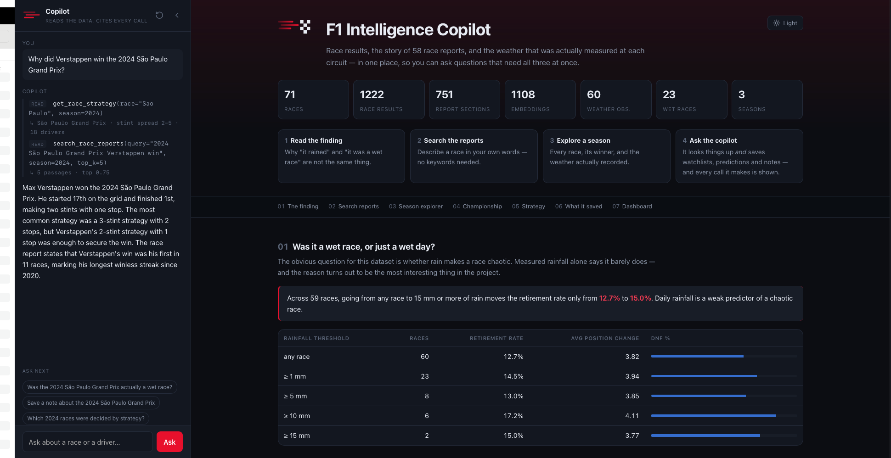
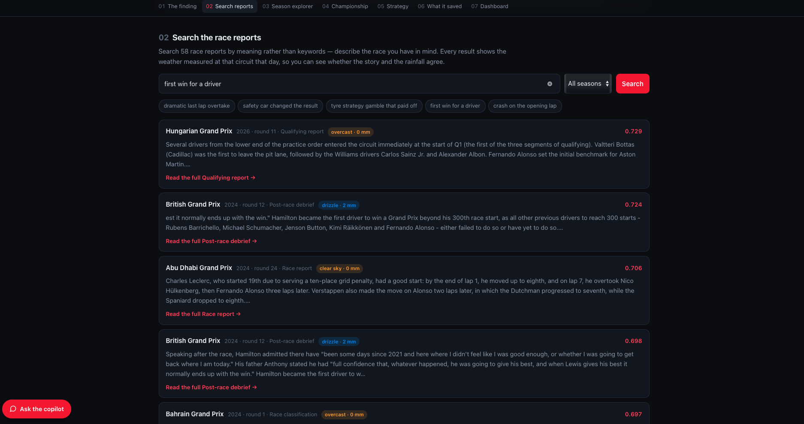
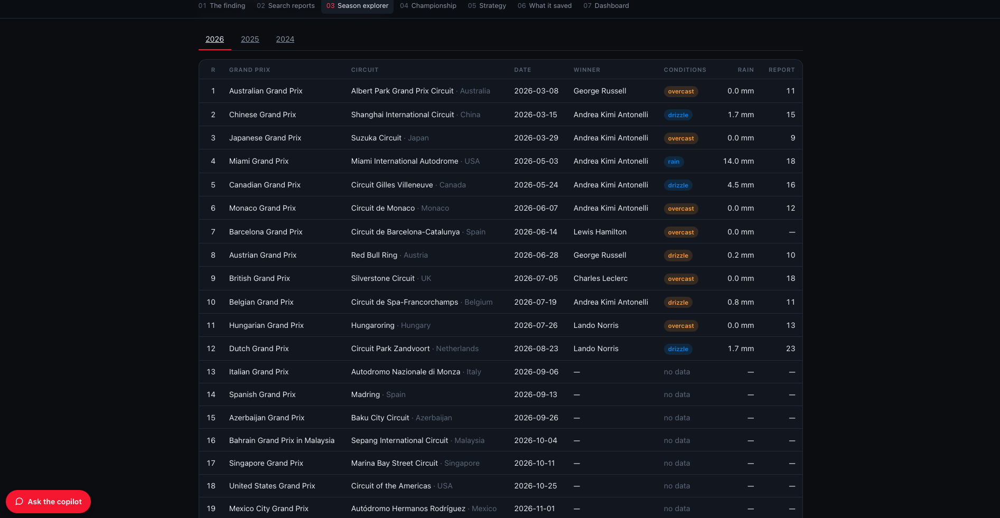
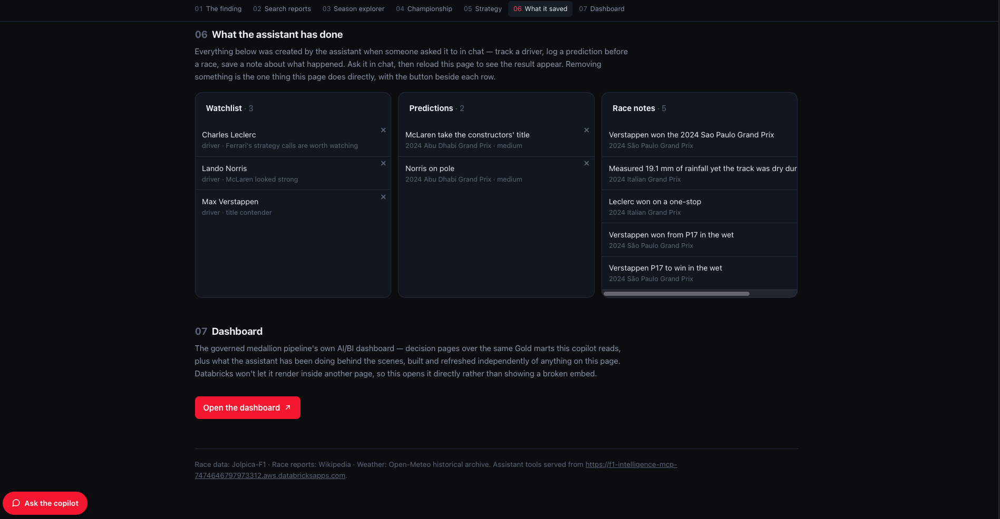
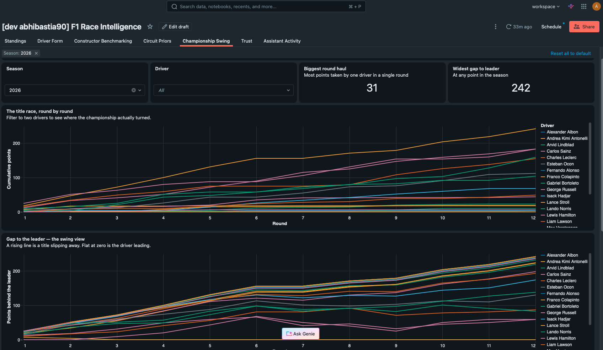
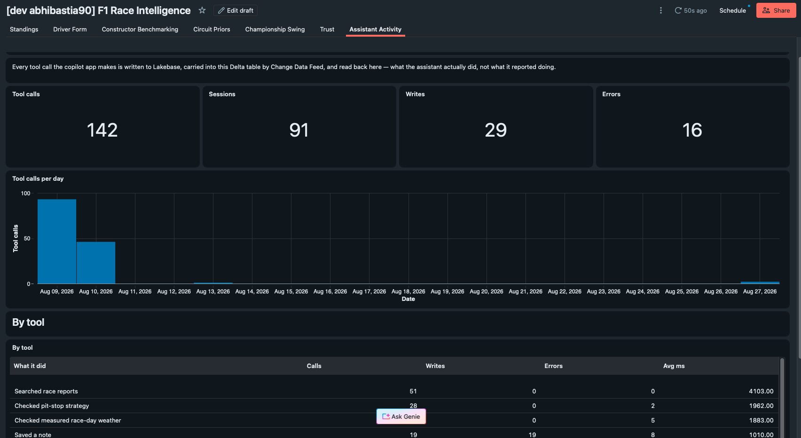
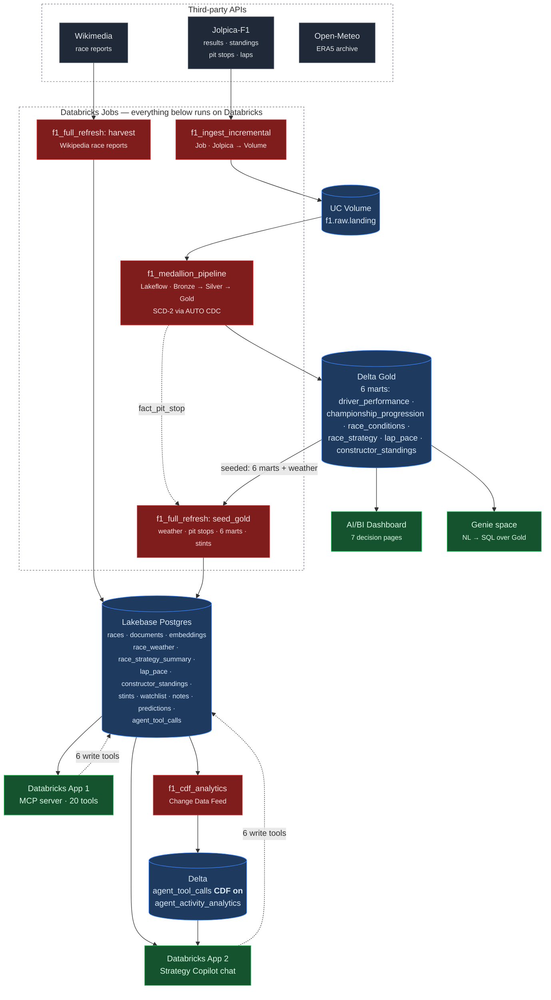

# F1 Intelligence Copilot

[](https://github.com/abhibastia/f1-intelligence-copilot/actions/workflows/tests.yml)


**A governed Formula 1 data platform and an agentic strategy copilot, in one
system.** Three keyless public APIs land in a Unity Catalog Volume, a Lakeflow
Declarative Pipeline refines them Bronze → Silver → Gold, and three surfaces ask
questions of the result: an AI/BI dashboard, a Genie natural-language space, and
a chat copilot backed by Lakebase Postgres with semantic retrieval over
race-report prose and 20 read/write agent tools exposed over MCP.

Everything runs on Databricks Free Edition, fully serverless, deployed as a
single Asset Bundle. It grew from two originally-separate projects — a governed
medallion pipeline ([`docs/architecture.md`](docs/architecture.md)) and a
Lakebase-backed strategy copilot
([`docs/copilot_design.md`](docs/copilot_design.md)) — later merged.

Both apps sit behind Databricks OAuth on Free Edition, so there is no public URL
to click through. These are what they look like running:

<table>
<tr>
<td width="50%"><br><sub><b>The finding</b> — RAG grounded in race-report prose, cited inline</sub></td>
<td width="50%"><br><sub><b>Semantic search</b> — pgvector/HNSW over race reports, scored and cited</sub></td>
</tr>
<tr>
<td width="50%"><br><sub><b>Season Explorer</b> — governed Gold marts, served from Lakebase</sub></td>
<td width="50%"><br><sub><b>What it saved</b> — watchlist, predictions and notes, all written by the agent's own tools</sub></td>
</tr>
<tr>
<td width="50%"><br><sub><b>AI/BI Dashboard</b> — Championship Swing, one of 7 decision pages over Gold</sub></td>
<td width="50%"><br><sub><b>Assistant Activity</b> — every tool call, carried into Delta via Change Data Feed</sub></td>
</tr>
</table>

---

## 1. At a glance

| | |
|---|---|
| **Sources** | 3 public APIs, all keyless — Jolpica-F1 (results, timing, pit stops, laps), Wikimedia (race reports), Open-Meteo ERA5 (weather) |
| **Platform** | Databricks Free Edition · fully serverless · one Asset Bundle (1 pipeline, 4 jobs, 1 dashboard) |
| **Governed data** | Unity Catalog `f1` — 4 schemas · 11 Bronze streaming tables · 8 Silver facts · 3 dimensions (2 of them SCD-2) · 9 quarantine tables · 6 Gold marts · 1 metric view |
| **Finest grain** | Timed **laps** (driver × race × lap, 67,208 rows); 1,200 driver-race results across 59 completed rounds |
| **Serving store** | Lakebase Postgres — 13 tables · 2,665 prose chunks embedded at 384 dimensions in `pgvector`, HNSW with `vector_cosine_ops` |
| **Agent** | 20 MCP tools (14 read, 6 write) · Llama 3.3 70B via Databricks Foundation Model APIs · tool-calling loop capped at 5 turns |
| **Surfaces** | AI/BI dashboard (7 decision pages) · Genie NL→SQL space scoped to Gold · 2 Databricks Apps |
| **Quality** | 256 local tests · 14 SQL validation checks · ruff + pre-commit + GitHub Actions |
| **Code** | ~11.5k lines of Python and SQL across ~60 source files |

---

## 2. What it does and why

After a Grand Prix the interesting question is never *what* happened — the
results table answers that in a line. It is **why**. *Why did Ferrari lose a
race they led? Was an undercut the right call, or did the safety car simply
fall their way? Which races were actually decided by strategy rather than
pace?*

Answering that means holding three incompatible sources together:

| Source | Answers | Cannot answer |
|---|---|---|
| Results and timing | *what* happened, precisely | *why* |
| Race report prose | *why*, in expert language | anything numeric or comparable |
| Weather records | the conditions | **when**, within the race, they mattered |

This project joins all three on `(season, round)`: a governed pipeline makes the
numbers trustworthy, and an agent sits in front of all three sources at once.

### The finding that shaped the design

Rain looks like it should cause chaos. Across the seasons in this dataset,
moving from *any race* to *heavy rain* barely moves the retirement rate — the
wettest race on record was among the calmest. A weather archive reports a
**daily total** and cannot distinguish rain that fell overnight from rain that
fell during the race. The narrative can: semantic search over race reports
surfaces sentences like *"although rain had fallen earlier on Sunday, the track
was dry by the time the race began."*

**This is why the embeddings are load-bearing rather than decorative.** Delete
them and the product cannot answer its own core question, because causation
lives in the prose.

---

## 3. Architecture



**Dataflow in one line:** three APIs → governed Spark medallion (Delta) + a
Databricks job harvesting Wikipedia → three read surfaces off Gold (dashboard,
Genie, Lakebase) → agent reads and writes Lakebase → tool calls flow back to
Delta through Change Data Feed → surfaced in the chat app.

**Why Lakebase in addition to Gold.** Delta is analytical, Lakebase is
operational. Free Edition's daily compute quota is unrecoverable until the next
day, so an agent that spends a warehouse query per question dies mid-demo. All
six Gold marts are seeded into Postgres once — a handful of warehouse queries
total — and every agent read after that is free. The dashboard and Genie still
read Gold directly, because they are occasional, human-paced queries rather
than a per-turn cost.

---

## 4. Tech stack

| Layer | Technologies |
|---|---|
| **Ingestion** | Python 3.11 standard library only — no third-party dependency in the ingest path. Measured rate budget (0.5 req/s, 450/hr), provenance envelope per landed file, idempotent round-closing |
| **Lakehouse** | Databricks · Unity Catalog (catalogs, schemas, Volumes, grants) · Delta Lake · Apache Spark · **Lakeflow Declarative Pipelines** (`pyspark.pipelines`) · Auto Loader · **Auto CDC for SCD-2** · Change Data Feed · UC **metric view** |
| **Serving / OLTP** | **Lakebase** (Databricks-managed Postgres) · `pg8000` pure-Python driver · **`pgvector`** with an **HNSW** index on `vector_cosine_ops` |
| **Retrieval (RAG)** | `sentence-transformers` · **`BAAI/bge-small-en-v1.5`** (384-dim) · sentence-aware chunking (400/80, whole-sentence overlap) · asymmetric query instruction |
| **Agent** | **FastMCP** over streamable HTTP · Databricks Foundation Model APIs (`databricks-meta-llama-3-3-70b-instruct`) · 20 tools, thin over a single broker · structured errors carrying a `suggestion` |
| **Apps** | Databricks Apps ×2 · Flask + Jinja partials + vanilla JS and CSS (no build step, no `package.json`) |
| **BI / NL** | AI/BI (Lakeview) dashboard, 7 decision pages over 13 datasets · Genie space scoped to Gold plus the metric view |
| **IaC / orchestration** | **Databricks Asset Bundles** — 1 Lakeflow pipeline, 4 jobs, 1 dashboard, `dev`/`prod` targets · Databricks CLI · serverless compute throughout |
| **Quality** | pytest (unit, contract and integration) · ruff (lint + format) · pre-commit · GitHub Actions · SQL validation suite with a non-zero exit code |

---

## 5. Engineering highlights

Six things here that are hard to get right, each with the evidence it works.
Full reasoning in `CLAUDE.md` and [`docs/copilot_design.md`](docs/copilot_design.md) §12.

**1. Measuring retrieval quality rather than assuming it.** A naive 900-char
chunker packed 4–7 unrelated sentences per vector, burying the right answer for
"first win for a driver" at **rank 281 of 1,108**. Sentence-aware packing
(400/80) plus `BAAI/bge-small-en-v1.5` over `all-MiniLM-L6-v2` — both 384-dim,
so no migration — moved the top score to **0.73 from 0.58**. Verification caught
a second fault: both `app.yaml` files still pinned the old model, so deployed
apps embedded queries with MiniLM against a bge-small index. Mismatched vector
spaces raise no error; they return uniformly low scores. Hence measuring.

**2. Diagnosing a native-extension crash behind a generic error.** `import psycopg2` SIGABRTs inside a Databricks serverless `spark_python_task`: pandas, pyarrow and grpc have
already loaded native extensions and `psycopg2-binary`'s bundled OpenSSL
collides with them. It works locally *and* in the Apps runtime, surfacing only
in a real job as "Python process exited unexpectedly" — and sat filed as a
separate unsolved bug until someone read the driver logs. Pure-Python `pg8000`
makes the class of crash impossible rather than patched.

**3. Verifying persistence on a second connection.** `INSERT … RETURNING` via
the read helper returns a real row with a real id, then never commits — the
agent reports "saved" and the database disagrees. Only a read-back on a **new**
connection catches it, which is what `f1lake.schema.smoke_test()` does.

**4. Reconciling against an independent source.** Points summed from race
results alone leave **13 of 24** drivers short of their official total; adding
sprint points reconciles to **0 of 24** against a separately fetched standings
endpoint.

**5. Incremental analytics that stay correct across runs.** Filtering
`_change_type` stops double-counting within a Change Data Feed run but not
across them: the MERGE rewrites matched rows and re-emits `update_postimage`
each time, so after three runs the analytics claimed **235 calls against 157
rows**. A `row_number()` over `_commit_version` fixes it. A pinned
`startingVersion=1` separately fails once files age out
(`DELTA_UNSUPPORTED_TIME_TRAVEL_BEYOND_DELETED_FILE_RETENTION_DURATION`) — a
VACUUM boundary at 168 hours, not a CDF limit — so the job restarts from the current version,
because changes in an expired window are gone, not recoverable.

**6. Temporal joins that survive a driver changing team.** Gold joins
`dim_driver` and `dim_constructor` as of `race_date`, never the current row,
which would silently reattribute historical results to a driver's present team
— a wrong answer that looks plausible. Validation check 14 proves the join does
real work by reconciling published constructor standings against results summed
by as-of-race team, a tautology if both came from one source. `dim_driver` is
built from *results*, not `/drivers`, for the same reason: every `/drivers`
field is static, so the only attribute with history is the constructor.

## 6. The agent

**20 tools — 14 read, 6 write.** Full definitions in
[`mcp_server/f1_mcp_server.py`](mcp_server/f1_mcp_server.py); the in-app agent
calls the same `f1_broker` functions, so both surfaces run identical code and a
bug in one is a bug in both rather than a divergence.

| Read | Write |
|---|---|
| `get_driver_season` · `compare_constructors` | **`add_to_watchlist`** · **`remove_from_watchlist`** |
| `get_championship_standings` · `get_constructor_standings` | **`log_prediction`** · **`delete_prediction`** |
| `get_race_weather` · `find_wet_races` | **`save_race_note`** · **`delete_note`** |
| `search_race_reports` | |
| `get_race_strategy` · `find_strategy_races` | |
| `get_race_pace` | |
| `get_season_schedule` | |
| `get_watchlist` · `get_predictions` · `get_race_notes` | |

**Guardrails.** Never state a figure not returned by a tool; follow the
`suggestion` field on an error rather than guessing; report what a name
resolved to, so a wrong match is visible; treat missing weather as *no data*,
never as *fair weather*.

**Identity resolution is returned, never assumed.** Users say "Verstappen" and
"Monza"; the data says `max_verstappen` and `Italian Grand Prix`. Every read
reports what it matched, and an *ambiguous* name raises with candidates rather
than picking the first row. Accent folding works both directions ("Sao Paulo" ↔
"São Paulo"), and rename aliases are derived from the corpus — "Brazilian"
resolves the 2024 "São Paulo Grand Prix" with no hardcoded alias table.

Every answer in the chat app shows the calls that produced it **and what each
one returned**, because a tool name alone reads identically whether the tool
answered or came back empty. That is what makes the trace evidence rather than
decoration. Writes are marked in red with the stored row id.

---

## 7. Unstructured data and retrieval

Wikipedia race reports, split on MediaWiki section headings so a hit can cite
"from the Race section", chunked sentence-aware and embedded with
`BAAI/bge-small-en-v1.5` (384-dim) into Lakebase `pgvector` — **2,665 chunks** —
indexed with HNSW on `vector_cosine_ops` to match the `<=>` operator used at
query time. An index built with a different opclass is silently ignored and
degrades to a full scan.

HNSW rather than IVFFlat because IVFFlat picks centroids at build time and needs
representative rows to already exist, which is wrong for a table that starts
empty. Retrieval has a floor of 3 passages: a model asking for a single passage
gets a coin flip, and one run answered the Monza question correctly while the
next hedged because `top_k=1` drew a passage from the wrong race.

Wired into queries in `f1_broker.search_reports`, which joins each hit to that
race's **measured** weather — sourced from Gold's `race_conditions` mart, not a
second fetch — so narrative and measurement can be checked against each other.

---

## 8. Change Data Feed loop

```
Lakebase agent_tool_calls          agent writes here on every tool call
   │  MERGE, idempotent on id
   ▼
f1.gold.agent_tool_calls           Delta, delta.enableChangeDataFeed = true
   │  table_changes()
   ▼
f1.gold.agent_activity_analytics   per-tool calls, writes, errors, latency
   │
   ▼  app "Agent activity" section
```

Recomputing from the base table instead would give the same numbers today and
stop being true the moment history is corrected or backfilled.

This is distinct from the medallion pipeline's own CDC (SCD-2 via
`create_auto_cdc_flow`) and from the pipeline's decision **not** to enable CDF
on its Silver/Gold tables, which are materialized views and cannot support it —
`table_changes()` on one returns
`[MATERIALIZED_VIEW_UNSUPPORTED_OPERATION]`. That constraint applies to the
pipeline's datasets, not to this plain, streaming-compatible `agent_tool_calls`
table.

---

## 9. Testing and data quality

**256 tests across 14 local modules.** Integration tests open a real Lakebase
connection and clean up every row they write; they skip cleanly when no
credentials exist, which is exactly the environment a public CI runner has, so
plain `pytest` is enough.

- **`CLAUDE.md`'s design decisions are enforced as tests**, not remembered.
  [`tests/test_repo_contracts.py`](tests/test_repo_contracts.py) asserts no
  legacy `dlt` imports, SCD-2 double-underscore columns, no pinned profile in
  `databricks.yml`, every job bounded and alerting, every scheduled job
  validating, no stale mart or dashboard-page count anywhere in prose, and no
  drift between the generated app payloads and their canonical sources.
- **The Spark suite executes the real pipeline files** with a stubbed `dp`
  module, so no transformation logic is restated in the test — a test that
  restates the expression it is testing passes forever, including after that
  expression becomes wrong. It runs on Databricks as the first task of
  `f1_end_to_end`.
- **[`sql/validation_checks.sql`](sql/validation_checks.sql) — 14 checks**, 11 of
  them run with an exit code by `scripts/validate_marts.py` as the final task of
  both jobs. Two independent endpoints must reconcile; `dim_driver` must return
  historical rows; no Silver fact may have duplicate natural keys; lap timings
  must agree with reported laps completed; every pit stop must fall inside its
  race.
- **The quarantine census is deliberately non-zero.** Around 89 lap rows fail
  the plausible-lap-time expectation (red-flag and safety-car laps) and a
  handful of standings rows have no position. Zero everywhere would mean the
  expectations had stopped being evaluated.
- CI runs `ruff check`, `ruff format --check` and the credential-free half of the
  suite on every push and pull request; `pre-commit` runs the same lint locally.

---

## 10. Repository layout

| Path | What | Layer |
|---|---|---|
| `src/ingestion/`, `src/pipeline/` | **Governed Spark medallion**: ingestion, Bronze→Gold (6 marts), SCD-2 | Pipeline |
| `sql/` | Validation checks, data-quality event-log queries, the `driver_metrics` metric view | Pipeline |
| `dashboards/` | AI/BI dashboard definition — 7 decision pages | Pipeline |
| `genie/` | Genie space scoped to Gold + the metric view | Pipeline |
| `harvest/` | Wikipedia race reports — runs as a Databricks job (`jobs/run_harvest.py`) or locally for testing | Copilot |
| `f1lake/` | Lakebase schema, loaders, embedding, Gold→Lakebase seeding | Copilot |
| `jobs/` | Databricks job entry points for harvest, embed, seed_gold | Copilot |
| `mcp_server/` | MCP server app — 20 tools over streamable HTTP | Copilot |
| `app/` | Strategy Copilot app — frontend, in-process agent, dashboards | Copilot |
| `notebooks/` | CDF→Delta analytics job | Copilot |
| `resources/`, `databricks.yml` | One Asset Bundle: pipeline, jobs, dashboard | Shared |
| `scripts/` | Catalog provisioning, access control, bootstrap, app build, validation | Shared |
| `tests/` | Pipeline contract tests, agent/resolution tests, bundle checks | Shared |
| `data/` | Harvested source data (gitignored except demo transcripts) | Shared |
| `docs/architecture.md` | Pipeline design record and data dictionary | Pipeline |
| `docs/copilot_design.md` | Agent/RAG design record | Copilot |
| `docs/setup.md` | Setup and the end-to-end run commands | Shared |
| `docs/runbook.md` | Operations and failure modes | Pipeline |

---

## 11. Running it

Full prerequisites, Lakebase provisioning, secrets and the step-by-step run
order live in **[`docs/setup.md`](docs/setup.md)**. The short version, once a
Databricks profile and a `f1` catalog exist:

```bash
./scripts/create_catalog.sh                                      # schemas + landing Volume
databricks bundle deploy -t dev --profile <profile>
databricks bundle run f1_end_to_end  -t dev --profile <profile>  # ingest → pipeline → validate
databricks bundle run f1_full_refresh -t dev --profile <profile> # harvest → embed → seed → CDF
```

Every command in this repository takes an explicit `--profile` — a pinned
profile means a fork deploys against a workspace its author never heard of.

---

## 12. Known limitations

- **Tyre compounds do not exist in this data.** Jolpica inherits Ergast's
  schema, which has no compound field. Tyre strategy is answered from the race
  report's own "Tyre choices" section instead.
- **No pace-degradation simulation.** What's offered is counterfactual
  comparison against what actually happened, via `get_race_pace` and
  `get_race_strategy`.
- **Weather is a daily total.** ERA5 gives one observation per day — the
  project's central finding, not a hidden flaw.
- **`f1_race_weather` no longer carries `wind_gusts_max` or `temp_mean`.**
  `race_conditions` doesn't compute them at its grain.
- **No formal retrieval evaluation.** There is no eval set, no scorers and no
  automated recall/nDCG measurement; retrieval quality was verified by hand
  (§5) and is guarded by property tests, not metrics.
- **Single user.** Writes are keyed `user_id='default'`.
- **The access model cannot be demonstrated on a single-owner workspace.**
  Grants are applied and correct, but ownership outranks every one of them.

---

## 13. Further reading

- [`docs/architecture.md`](docs/architecture.md) — pipeline design record and
  data dictionary (§7.1)
- [`docs/copilot_design.md`](docs/copilot_design.md) — agent/RAG design record,
  including every bug that changed the design (§12)
- [`docs/setup.md`](docs/setup.md) — setup and end-to-end run commands
- [`docs/runbook.md`](docs/runbook.md) — operations and failure modes
- [`CLAUDE.md`](CLAUDE.md) — standing constraints, read before changing anything

---

## License

[MIT](LICENSE).
